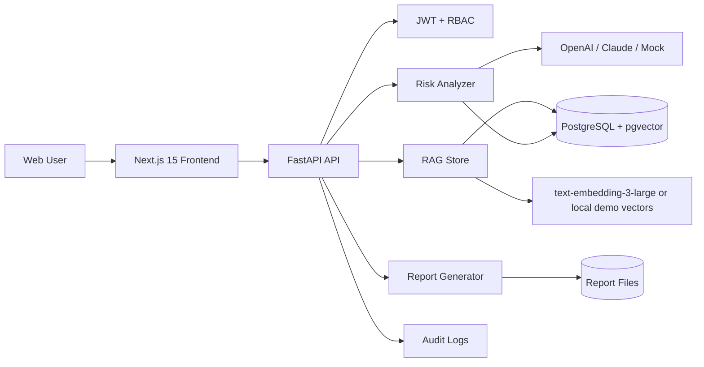
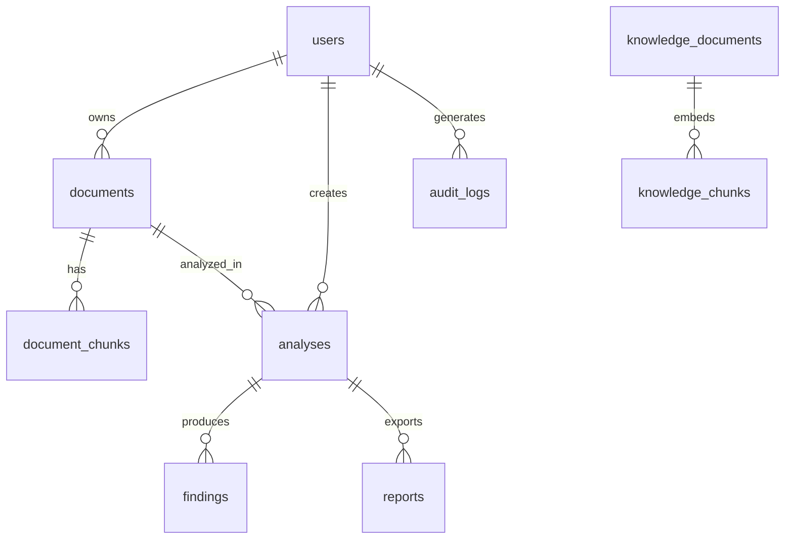
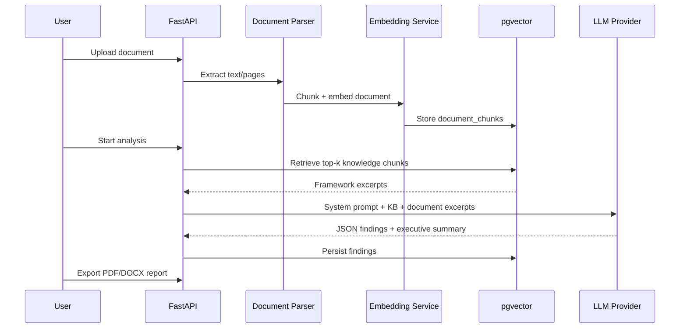

# AI Risk Investigator

Production-oriented SaaS for auditors, risk managers, compliance officers, and legal teams to upload contracts, policies, financial reports, and audit evidence — then receive evidence-backed AI risk findings, executive summaries, and downloadable audit reports.

> Demo mode ships with a deterministic mock LLM so the stack runs without API keys. Set `OPENAI_API_KEY` / `ANTHROPIC_API_KEY` and `DEFAULT_LLM_PROVIDER` for live models (`gpt-4.1`, `gpt-5` when available on your account, or Claude).

## Features

- **Document upload** — PDF, DOCX, TXT
- **AI risk analysis** — compliance, operational, financial, legal, data privacy, vendor, AI governance
- **Risk scoring** — severity / probability / impact
- **Evidence extraction** — finding, explanation, supporting text, page number, confidence
- **RAG knowledge base** — regulations & frameworks (SOX, ISO 27001, COSO, GDPR, AI Act, SOPs)
- **Executive summary + heatmap**
- **Audit report export** — PDF and DOCX
- **Security** — JWT auth, RBAC, audit logs, rate limiting
- **Observability** — structured JSON logs, OpenTelemetry tracing

## Architecture



## ER Diagram



## RAG Flow



## Repository Layout

```
ai-risk-investigator/
├── backend/                 # FastAPI app
│   ├── app/
│   │   ├── api/             # HTTP routes
│   │   ├── analyzer/        # Risk analysis orchestration
│   │   ├── rag/             # Embeddings + retrieval
│   │   ├── reporting/       # PDF/DOCX generation
│   │   ├── services/        # Parser, LLM, storage, audit
│   │   ├── models/          # SQLAlchemy entities
│   │   └── schemas/         # Pydantic contracts
│   ├── alembic/             # Migrations
│   └── tests/
├── frontend/                # Next.js 15 + Tailwind + Recharts
├── docs/openapi.yaml
├── examples/                # Sample contract + KB excerpts + sample report
├── docker-compose.yml
└── .github/workflows/ci.yml
```

## Quick Start (Docker)

```bash
cd ai-risk-investigator
cp .env.example .env
docker compose up --build
```

- Web: http://localhost:3000  
- API: http://localhost:8000  
- OpenAPI UI: http://localhost:8000/docs  
- Static OpenAPI: [docs/openapi.yaml](docs/openapi.yaml)

### First login

1. Open http://localhost:3000/login  
2. Register an account (first user becomes `admin`)  
3. Upload `examples/documents/sample_vendor_contract.txt`  
4. Review findings, then export a PDF from **Reports**

### Seed knowledge base (optional)

```bash
TOKEN=<access_token>
curl -X POST http://localhost:8000/api/v1/knowledge \
  -H "Authorization: Bearer $TOKEN" \
  -F "file=@examples/knowledge/gdpr_excerpt.txt" \
  -F "title=GDPR Excerpts" \
  -F "source_type=regulation" \
  -F "framework=GDPR"
```

## Local Development

### Backend

```bash
cd backend
python -m venv .venv
# Windows: .venv\Scripts\activate
pip install -e ".[dev]"
cp .env.example .env
# start Postgres with pgvector, then:
alembic upgrade head
uvicorn app.main:app --reload --port 8000
pytest -q
```

### Frontend

```bash
cd frontend
npm install
echo NEXT_PUBLIC_API_URL=http://localhost:8000 > .env.local
npm run dev
```

## Configuration

| Variable | Purpose |
|----------|---------|
| `DEFAULT_LLM_PROVIDER` | `openai` \| `anthropic` \| `mock` |
| `OPENAI_MODEL` | e.g. `gpt-4.1` or `gpt-5` |
| `ANTHROPIC_MODEL` | Claude model id |
| `EMBEDDING_MODEL` | `text-embedding-3-large` |
| `DEMO_MODE` | Use mock LLM / local embeddings when keys absent |
| `JWT_SECRET_KEY` | **Required** strong secret in production |

## Security Model

| Role | Capabilities |
|------|----------------|
| `viewer` | Read findings/dashboard |
| `compliance` | + upload knowledge base |
| `risk_manager` / `auditor` | + upload docs, run analysis, export reports |
| `admin` | Full access |

All mutating actions write to `audit_logs` with user, IP, and user-agent.

## Testing

- Backend: `pytest` (parser, security, mock LLM, health)
- Frontend e2e: Playwright (`npm run test:e2e` with app running)
- CI: GitHub Actions builds frontend and runs backend unit tests

## Production Notes

1. Rotate `JWT_SECRET_KEY`; disable weak defaults  
2. Set `APP_ENV=production`, `DEMO_MODE=false`, real LLM keys  
3. Put object storage in front of `/data` volumes (S3/MinIO) for multi-instance  
4. Add managed Postgres with pgvector; tune IVFFlat/HNSW after data volume exists  
5. Terminate TLS at reverse proxy; restrict CORS  
6. Human review is mandatory — LLM findings are decision support, not legal opinions

## License

MIT — see project use constraints for your organization.
